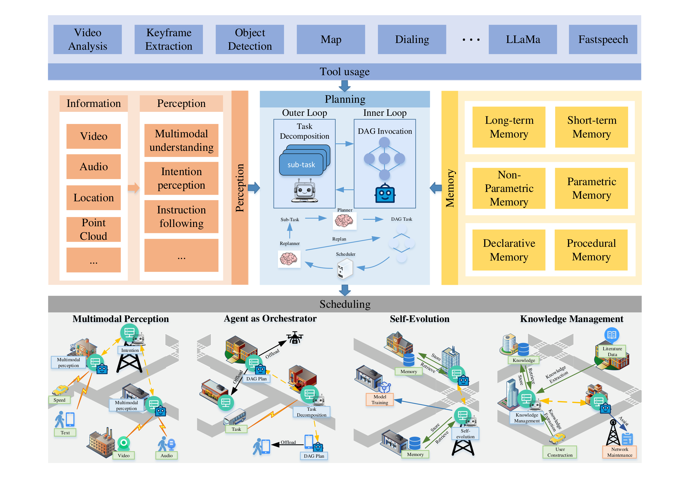
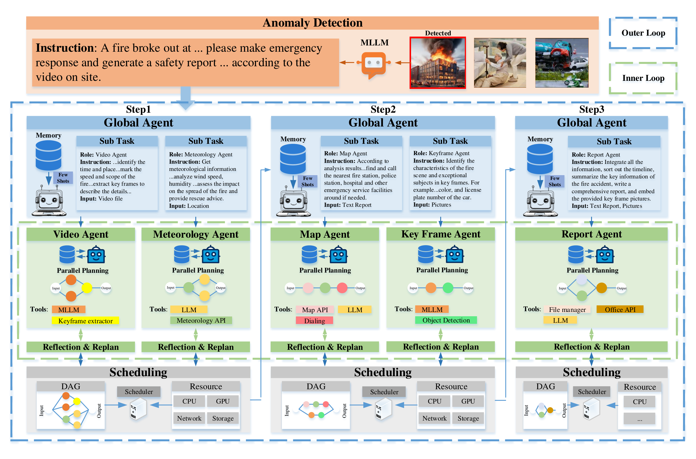
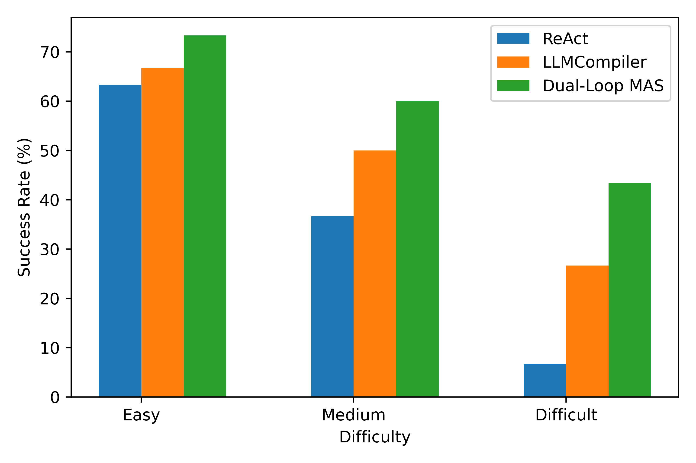
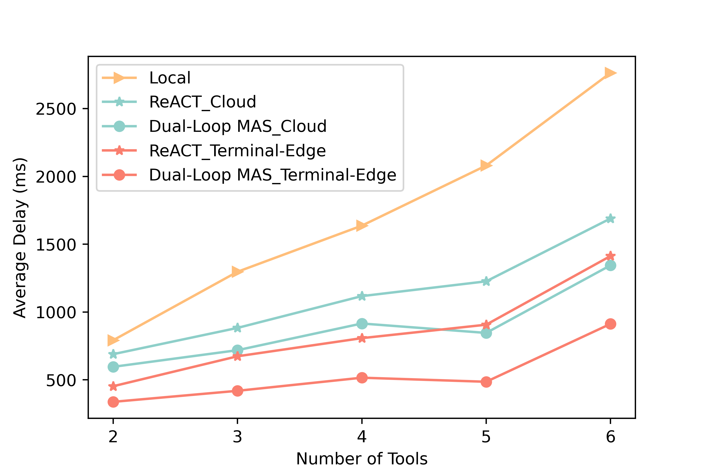

<div align="center">

# LLM Enabled Multi-Agent System for 6G Networks:<br>Framework and Method of Dual-Loop Edge-Terminal Collaboration

**Zheyan Qu**<sup>1</sup> &nbsp;
**Wenbo Wang**<sup>1†</sup> &nbsp;
**Zitong Yu**<sup>1</sup> &nbsp;
**Boquan Sun**<sup>1</sup> &nbsp;
**Yang Li**<sup>1</sup> &nbsp;
**Xing Zhang**<sup>1†</sup>

<sup>1</sup>Beijing University of Posts and Telecommunications

<sup>†</sup>Corresponding authors

[](https://arxiv.org/abs/2509.04993)


</div>

<p align="center">
  
</p>

<p align="center"><em>
The dual-loop multi-agent system with terminal-edge collaboration. The perception module turns multimodal information into understanding and intentions, the planning module decomposes the task in the outer loop and generates parallel tool-calling DAGs in the inner loop, the memory module supplies stored knowledge and experiences, and the planned tool calls are scheduled for execution. The bottom row illustrates multimodal perception, agent as orchestrator, self-evolution and knowledge management.
</em></p>

## News

- **2025-09-05**: The first version of the paper is on [arXiv](https://arxiv.org/abs/2509.04993).

## Highlights

6G networks place computing resources everywhere, from terminals to edge servers, which makes them a natural home for LLM-enabled agents. Yet the limited resources of individual network devices hinder the efficient operation of LLM-enabled agents with complex tool calls, which calls for efficient collaboration across multiple levels of devices. We propose a multi-agent system that splits the work across a global agent and sub-agents on edge servers and terminals, and validate its improved task planning capability and task execution efficiency.

- **LLM-enabled agents for 6G functions.** We summarize how LLM-enabled agents can realize four 6G functions, namely perception and cognition, orchestration, self-adaption and self-evolution, and knowledge management, and uncover the existing research gaps.
- **A dual-loop framework with edge-terminal collaboration.** In the outer loop, a global agent on the edge decomposes a request into parallel sub-tasks and hands them to role-specific sub-agents on terminals. In the inner loop, each sub-agent generates a parallel tool-calling DAG with LLMCompiler, reflects and replans, and offloads tool execution to heterogeneous edge and terminal devices through a scheduler.
- **Validation in urban emergency response.** On an emergency-response task set of easy, medium and hard tasks, the dual-loop system achieves the highest planning success rate at every difficulty level, reaching 43.3% on hard tasks where ReAct reaches 6.7% and LLMCompiler 26.7%. Its parallel execution with terminal-edge collaboration also gives the lowest latency for every number of tools called.

## How it works

The framework is built from multimodal perception, memory, planning and scheduling, as shown in the figure above.

**Multimodal perception.** The perception module denoises and aligns signals of different modalities (video, audio, location, point clouds) into a format the agent can process, and recognizes user intentions. Without explicit instructions, it infers scene semantics on its own, for example issuing first-aid and traffic-warning instructions when an anomaly is detected; with explicit instructions, it serves as the interface to the user, for example converting user instructions into network parameters in 6G network management.

**Memory.** The memory module stores interaction context, 6G knowledge and action experiences, and supports self-evolution. Though they may overlap, it can generally be divided as follows:

- **Short-term / long-term memory**: real-time context and reasoning history versus network knowledge and summarized action experiences.
- **Non-parametric / parametric memory**: data kept in original formats such as textual beliefs, images and signals, which can be embedded into vectors and retrieved, versus parameters from self-fine-tuning, such as LoRA matrices that can be loaded without reloading the whole model.
- **Declarative / procedural memory**: facts such as user preferences and profiles versus "skills", i.e. strategies for acting in specific scenarios.

**Planning with two loops.**

- **Outer loop.** The global agent on the edge decomposes a complex task into parallel sub-tasks, assigns them to sub-agents with different roles, and aggregates their outcomes to generate the next round of sub-tasks. Decomposition counters the loss of critical context and the planning hallucinations that complex tasks cause, lets parallel sub-agents improve execution efficiency, allows smaller models on sub-agents because sub-tasks need fewer reasoning steps, and let each edge-side global agent cover its own region, giving safe isolation and scalability.
- **Inner loop.** Each sub-agent, placed close to the sensors and tools it needs, uses LLMCompiler to generate a tool-calling DAG instead of sequential calls, dispatches the tools to computing nodes, and adjusts the DAG from execution feedback (replanning).

**Scheduling.** Tools range from classic algorithms to machine learning models and LLMs, and terminals and edge devices in 6G have heterogeneous computing resources, so the resource demands of tools must be matched to the supply of devices. Because LLMs alone cannot achieve efficient scheduling and precise resource division, scheduling algorithms are incorporated into the toolkit, and the agent selects the algorithm that suits the current service and network state to offload tool execution to edge and terminal devices.

## Case study: urban emergency response

<p align="center">
  
</p>

<p align="center"><em>
One case of parallel task planning within an urban emergency response task. An MLLM detects a fire in a video and issues an instruction; over three steps, the global agent dispatches sub-tasks to a Video Agent, Meteorology Agent, Map Agent, Keyframe Agent and Report Agent, each of which plans its tool calls in parallel, reflects and replans, and runs them through the scheduler.
</em></p>

### Higher planning success rate

<p align="center">
  
</p>

<p align="center"><em>
Success rate (%) of ReAct, LLMCompiler and the dual-loop MAS on easy, medium and hard emergency-response tasks.
</em></p>

| Scheme | Easy (1–3 tools) | Medium (4–6 tools) | Hard (7–9 tools) |
|---|---:|---:|---:|
| ReAct | 63.3 | 36.7 | 6.7 |
| LLMCompiler | 66.7 | 50.0 | 26.7 |
| Dual-Loop MAS | **73.3** | **60.0** | **43.3** |

As tasks become harder, the success rate of all three schemes drops because of longer reasoning and context. ReAct, which plans sequentially, quickly hits early stops and terminates before the task is complete, falling from 63.3% on easy tasks to 6.7% on hard ones. The dual-loop system performs best at every difficulty level, and its lead grows with difficulty: 6.6 points over LLMCompiler on easy tasks, 10.0 on medium tasks and 16.6 on hard tasks. Decomposition turns one hard planning problem into several simpler ones, and few-shot experiences from memory further reduce reasoning hallucinations.

### Lower execution latency

<p align="center">
  
</p>

<p align="center"><em>
Average delay (ms) of tool execution against the number of tools called, for local execution and for ReAct and the dual-loop MAS with cloud execution or terminal-edge collaboration.
</em></p>

Counting only successfully planned and executed tasks, terminal-edge collaboration achieves lower latency than cloud execution for both ReAct and the dual-loop MAS, and all of them are faster than local execution, whose delay grows fastest with the number of tools. Because the dual-loop system executes a parallel tool topology while ReAct's is sequential, its latency is lower again under both cloud execution and terminal-edge collaboration. With six tools, the dual-loop MAS with terminal-edge collaboration needs about a third of the delay of local execution.

### Beyond emergency response

The framework extends to other 6G scenarios. In network slicing management, for example, sub-agents take on intent analysis, resource coordination and lifecycle management with slice modeling and deployment tools, while the global agent plans and decomposes the overall task. The same pattern applies to satellite-ground communication and digital twins.

## Open challenges

- **Flexible on-device deployment.** Cloud-hosted LLMs require uploading all interaction details, so user privacy cannot be guaranteed. On-device LLMs tailored to 6G operations and task planning, pretrained with more network knowledge, are needed to balance capability and resource consumption.
- **Reasoning ability and context window.** Agents need dozens of reasoning steps to determine tool calls and their parameters, which strains limited context windows and reasoning ability. Multi-agent systems help to some extent, but with long contexts the base LLM often fails to extract the needed details, leading to early stops or task failure.
- **Communication overhead and security.** Multi-round exchanges of private data and execution parameters add communication overhead and leakage risks. Key-information extraction and routing mechanisms can reduce communication volume, while encrypted communication and distributed training, such as federated fine-tuning for parametric memory, can prevent privacy leakage.
- **Hallucination.** Generated content may conflict with user inputs, context or world knowledge, even when accurate 6G knowledge is provided as reference. Agent systems may not detect such hallucinations promptly, which calls for external supervisors and evaluators.

## Copyright

© 2025 IEEE. Personal use of this material is permitted. Permission from IEEE must be obtained for all other uses, in any current or future media, including reprinting/republishing this material for advertising or promotional purposes, creating new collective works, for resale or redistribution to servers or lists, or reuse of any copyrighted component of this work in other works.

## Acknowledgment

This work was supported by the National Science Foundation of China under Grant 62271062.

## Citation

If you find this work useful, please cite:

```bibtex
@article{qu2026dualloop,
  title   = {LLM Enabled Multi-Agent System for 6G Networks: Framework and Method of Dual-Loop Edge-Terminal Collaboration},
  author  = {Qu, Zheyan and Wang, Wenbo and Yu, Zitong and Sun, Boquan and Li, Yang and Zhang, Xing},
  journal = {IEEE Communications Magazine},
  volume  = {64},
  number  = {3},
  pages   = {54--60},
  month   = {March},
  year    = {2026},
  doi     = {10.1109/MCOM.001.2500148}
}
```

## Contact

For questions, please contact the first author Zheyan Qu (zheyanqu@bupt.edu.cn) and corresponding author Xing Zhang (zhangx@ieee.org).
